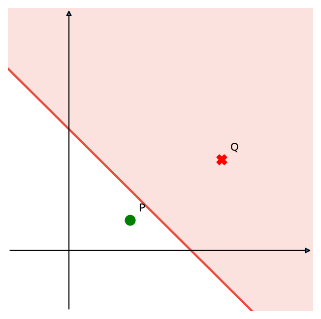
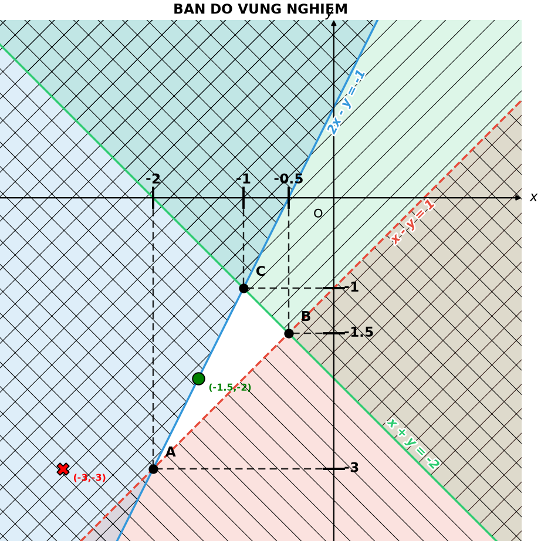
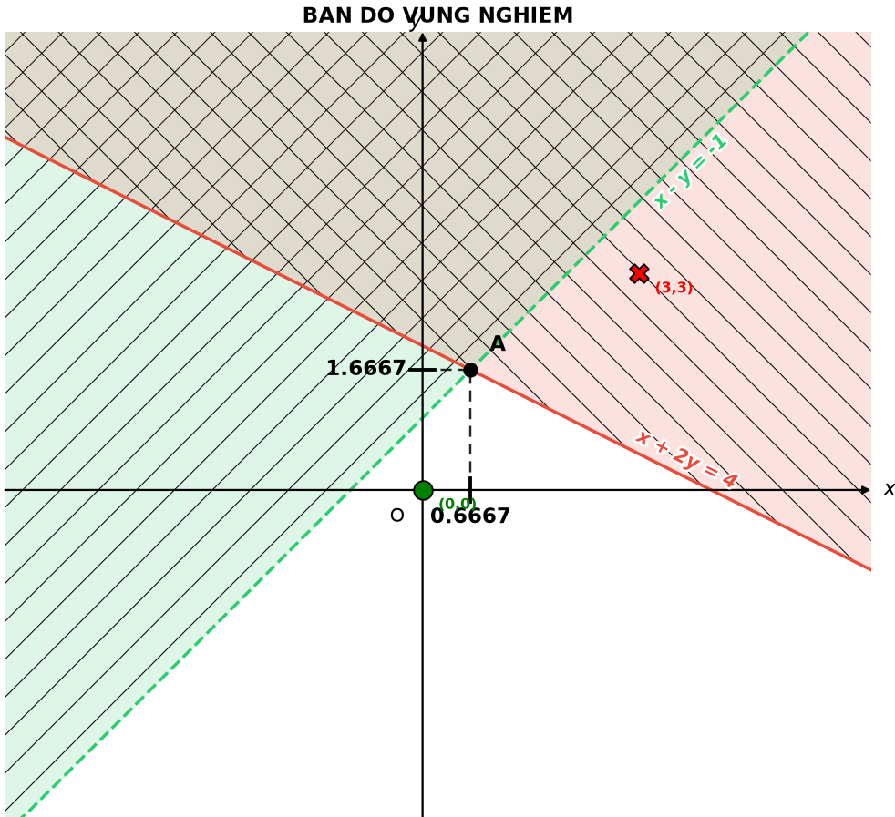
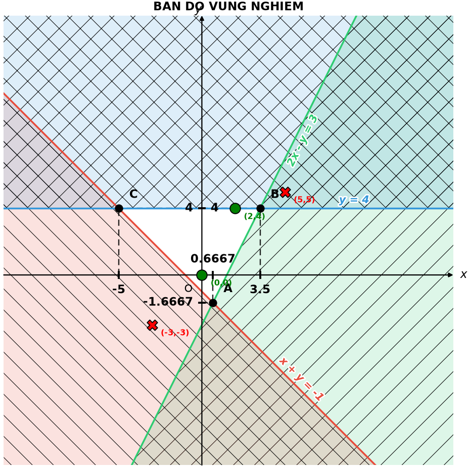
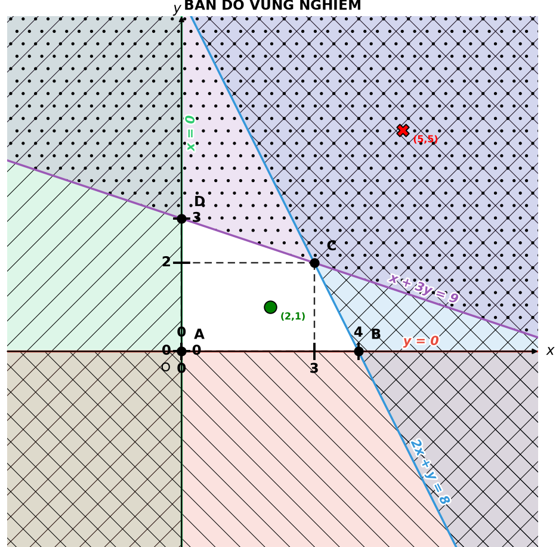

# Hebatphuongtrinhbacnhathaian: Bản đồ vùng nghiệm

Kho lưu trữ mã nguồn và tài liệu đi kèm tiểu luận **"Ứng dụng SymPy vào bài toán Hệ bất phương trình bậc nhất hai ẩn"** của nhóm sinh viên Trường Đại học Sư phạm Huế.

Chương trình Python `hpt2an.py` nhận hệ bất phương trình bậc nhất hai ẩn dưới dạng chuỗi, tự động xác định miền nghiệm, kiểm tra điểm thử và vẽ "bản đồ vùng nghiệm". Đây là mã lệnh được chạy ở Chương 3 của tiểu luận; các hình minh họa trong kho là hình dùng trong `main.tex`.

## Mục lục

- [Giới thiệu](#giới-thiệu)
- [Chức năng](#chức-năng)
- [Công nghệ và thư viện](#công-nghệ-và-thư-viện)
- [Cài đặt và chạy](#cài-đặt-và-chạy)
- [Hướng dẫn sử dụng](#hướng-dẫn-sử-dụng)
- [Cú pháp đầu vào](#cú-pháp-đầu-vào)
- [Ví dụ minh họa](#ví-dụ-minh-họa)
- [Cách đọc hình vẽ](#cách-đọc-hình-vẽ)
- [Cấu trúc kho và mã nguồn](#cấu-trúc-kho-và-mã-nguồn)
- [Biên dịch tiểu luận](#biên-dịch-tiểu-luận)
- [Hạn chế và lưu ý](#hạn-chế-và-lưu-ý)
- [Ý nghĩa trong dạy học](#ý-nghĩa-trong-dạy-học)
- [Hướng phát triển](#hướng-phát-triển)
- [Tác giả và giấy phép](#tác-giả-và-giấy-phép)

## Giới thiệu

Một hệ bất phương trình bậc nhất hai ẩn có dạng

$$
\begin{cases}
a_1x+b_1y\ \square\ c_1,\\
a_2x+b_2y\ \square\ c_2,\\
\ \ \vdots
\end{cases}
\qquad(\square\in\{<,\ \le,\ >,\ \ge\})
$$

Tập nghiệm của hệ là giao của các nửa mặt phẳng, gọi là miền nghiệm. Chương trình giải bài toán này theo hướng hình học: tìm đỉnh, xác định miền nghiệm bị chặn hay không bị chặn, phân biệt đường biên nghiêm ngặt và không nghiêm ngặt, rồi vẽ hình.

## Chức năng

Các chức năng đã được triển khai trong `hpt2an.py`:

- Phân tích từng bất phương trình dạng chuỗi bằng SymPy, đưa về dạng $ax+by\ \square\ c$ với hệ số $a,b,c$ và dấu so sánh.
- Tìm các đỉnh của miền nghiệm: lấy giao của từng cặp đường biên, giữ lại những giao điểm thỏa **tất cả** bất phương trình (xét cả biên).
- Xác định miền nghiệm là đa giác khép kín (bị chặn), mở rộng vô hạn (không bị chặn) hay vô nghiệm, bằng cách cắt một hình vuông rất lớn qua từng nửa mặt phẳng (thuật toán Sutherland–Hodgman).
- Với miền bị chặn, đặt tên đỉnh A, B, C, … theo chiều ngược kim đồng hồ. Với miền không bị chặn, in ra các đỉnh hữu hạn, các cạnh hữu hạn và hướng các tia vô hạn.
- Phát hiện cạnh nằm trên đường biên của bất phương trình **nghiêm ngặt** (`<`, `>`) và ghi rõ cạnh đó không thuộc miền nghiệm.
- Kiểm tra điểm thử có thuộc miền nghiệm hay không, và nêu bất phương trình bị vi phạm.
- Vẽ bản đồ vùng nghiệm bằng Matplotlib (xem [Cách đọc hình vẽ](#cách-đọc-hình-vẽ)).

Chưa có trong chương trình: lưu ảnh tự động, giao diện nhập liệu, kiểm thử tự động.

## Công nghệ và thư viện

| Thư viện | Vai trò trong `hpt2an.py` |
|---|---|
| Python 3 | Ngôn ngữ chương trình (mã dùng f-string nên cần Python 3.6 trở lên) |
| SymPy | Khai báo biến thực `x`, `y` (`symbols`); phân tích chuỗi thành quan hệ (`sympify`); lấy dấu và hai vế (`rel_op`, `lhs`, `rhs`); đưa về dạng $ax+by-c$ (`expand`, `coeff`, `subs`) |
| NumPy | Giải hệ hai phương trình tìm giao điểm đường biên (`linalg.det`, `linalg.solve`); tạo lưới điểm (`linspace`, `meshgrid`); sắp xếp đỉnh theo góc (`arctan2`) |
| Matplotlib | Vẽ hình: tô và gạch phần không phải nghiệm (`contourf`), đường biên (`axline`), nhãn và chú thích (`annotate`, `patheffects`) |
| `itertools` (thư viện chuẩn) | Duyệt mọi cặp đường biên (`combinations`) |

Hàm `ax.axline` của Matplotlib chỉ có từ phiên bản 3.3 trở lên.

## Cài đặt và chạy

Kiểm tra Python:

```bash
python --version
```

Tải mã nguồn và cài thư viện:

```bash
git clone https://github.com/duongtam230905-arch/Hebatphuongtrinhbacnhathaian.git
cd Hebatphuongtrinhbacnhathaian
python -m venv venv
# Windows:        venv\Scripts\activate
# macOS / Linux:  source venv/bin/activate
pip install sympy matplotlib numpy
```

Chạy phần demo có sẵn trong tệp:

```bash
python hpt2an.py
```

Lệnh này in kết quả ra màn hình rồi mở cửa sổ hình vẽ của Matplotlib (hàm `plt.show()`), nên cần môi trường có giao diện đồ họa. Kho hiện chưa có `requirements.txt`; có thể tạo tệp này với ba dòng `sympy`, `numpy`, `matplotlib` nếu muốn.

## Hướng dẫn sử dụng

Có thể dùng chương trình như một thư viện: các lệnh chạy demo nằm trong khối `if __name__ == "__main__":` nên nhập hàm sẽ không tự chạy demo.

```python
from hpt2an import giai_he_bpt, ve_ban_do

he_bpt = [
    "x + y <= 2",
    "x - y < 3",
    "2*x - y >= 1",
]
diem_test = [(-1.5, -2), (-3, -3)]

danh_sach_bpt, mo_ta = giai_he_bpt(he_bpt, diem_test=diem_test)
ve_ban_do(danh_sach_bpt, mo_ta, diem_test=diem_test, xlim=(-5, 3), ylim=(-5, 3))
```

Quy trình:

1. Khai báo hệ bất phương trình dưới dạng danh sách chuỗi.
2. Gọi `giai_he_bpt` để phân tích hệ, mô tả miền nghiệm và kiểm tra điểm thử. Kết quả được in ra màn hình.
3. Gọi `ve_ban_do` với kết quả của bước 2 để vẽ hình.
4. Đối chiếu kết quả in ra và hình vẽ với lời giải tính tay.

Hai hàm chính:

| Hàm | Tham số | Giá trị trả về |
|---|---|---|
| `giai_he_bpt(danh_sach_chuoi, diem_test=None)` | `danh_sach_chuoi`: danh sách chuỗi bất phương trình; `diem_test`: danh sách điểm `(x0, y0)` cần kiểm tra (không bắt buộc) | Bộ hai phần tử `(danh_sach_bpt, mo_ta)` |
| `ve_ban_do(danh_sach_bpt, mo_ta, diem_test=None, xlim=(-6, 6), ylim=(-6, 6))` | Hai kết quả của `giai_he_bpt`, điểm thử, và khung nhìn | Không trả về; mở cửa sổ hình |

Trong kết quả của `giai_he_bpt`:

- Mỗi phần tử của `danh_sach_bpt` là một từ điển với các khóa `a`, `b`, `c`, `op`, `chuoi_goc`, ứng với bất phương trình $ax+by\ \text{op}\ c$.
- `mo_ta` là từ điển với khóa `loai` nhận một trong ba giá trị `'vo_nghiem'`, `'bi_chan'`, `'khong_bi_chan'`, cùng các khóa `dinh`, `ten_dinh`, `canh_mo`.

## Cú pháp đầu vào

Mỗi bất phương trình là một chuỗi với hai biến `x`, `y` và một trong bốn dấu `<`, `<=`, `>`, `>=`.

| Nội dung | Quy ước |
|---|---|
| Dấu so sánh | `<=` và `>=` (không nghiêm ngặt, đường biên nét liền); `<` và `>` (nghiêm ngặt, đường biên nét đứt) |
| Phép nhân | Viết tường minh bằng `*`, ví dụ `2*x - y >= 1` |
| Hai vế | Cả hai vế đều có thể chứa biến, chương trình chuyển về dạng `vế trái − vế phải` |
| Hệ số | Phải là số (được chuyển sang kiểu `float`) |

Các đầu vào bị từ chối với `ValueError`:

- Chuỗi không phải là một bất phương trình hợp lệ.
- Chuỗi là phương trình (dấu `==`).
- Bất phương trình không chứa `x` hoặc `y` với hệ số khác 0.

Phương trình dùng dấu `=` đơn sẽ bị SymPy báo lỗi cú pháp ngay khi phân tích chuỗi.

## Ví dụ minh họa

### Ví dụ 1: hệ trong khối demo của `hpt2an.py`

$$
\begin{cases}
x+y\le 2,\\
x-y<3,\\
2x-y\ge 1.
\end{cases}
$$

Điểm thử: $(-1{,}5;\,-2)$ và $(-3;\,-3)$. Mã chạy xem ở mục [Hướng dẫn sử dụng](#hướng-dẫn-sử-dụng).

**Phân tích toán học (tính tay):**

| Cặp đường biên | Giao điểm | Thỏa cả ba bất phương trình (xét biên)? |
|---|---|---|
| $x+y=2$ và $x-y=3$ | $\left(\tfrac52;\,-\tfrac12\right)$ | Có |
| $x+y=2$ và $2x-y=1$ | $(1;\,1)$ | Có |
| $x-y=3$ và $2x-y=1$ | $(-2;\,-5)$ | Có |

Miền nghiệm là tam giác với ba đỉnh trên. Cạnh nối $(-2;-5)$ và $\left(\tfrac52;-\tfrac12\right)$ nằm trên đường $x-y=3$ của bất phương trình nghiêm ngặt nên không thuộc miền nghiệm; hai đầu mút của cạnh này cũng không thuộc miền nghiệm.

Cả hai điểm thử đều vi phạm bất phương trình thứ ba: với $(-1{,}5;-2)$ ta có $2x-y=-1<1$, với $(-3;-3)$ ta có $2x-y=-3<1$.

**Kết quả in ra dự kiến** (suy ra từ việc đọc mã, chưa chạy thử):

```text
======================================================================
HE BAT PHUONG TRINH BAC NHAT HAI AN:
  d1:  x + y <= 2
  d2:  x - y < 3
  d3:  2*x - y >= 1

MIEN NGHIEM:
  => Mien nghiem cua he bat phuong trinh tren la da giac ABC (khong tinh canh AB), voi A(-2, -5), B(2.5, -0.5), C(1, 1).

KIEM TRA CAC DIEM TEST:
  Diem (-1.5, -2): KHONG thuoc mien nghiem (vi pham: d3)
  Diem (-3, -3): KHONG thuoc mien nghiem (vi pham: d3)
======================================================================
```

### Ví dụ 2: hệ dùng trong tiểu luận

$$
\begin{cases}
x+y\le -2,\\
x-y<1,\\
2x-y\ge -1.
\end{cases}
$$

```python
he_bpt = ["x + y <= -2", "x - y < 1", "2*x - y >= -1"]
```

Điểm thử vẫn là $(-1{,}5;\,-2)$ và $(-3;\,-3)$.

**Phân tích toán học (tính tay):**

| Cặp đường biên | Giao điểm |
|---|---|
| $x+y=-2$ và $x-y=1$ | $\left(-\tfrac12;\,-\tfrac32\right)$ |
| $x+y=-2$ và $2x-y=-1$ | $(-1;\,-1)$ |
| $x-y=1$ và $2x-y=-1$ | $(-2;\,-3)$ |

Miền nghiệm là tam giác với ba đỉnh trên. Cạnh nối $(-2;-3)$ và $\left(-\tfrac12;-\tfrac32\right)$ nằm trên đường $x-y=1$ (nghiêm ngặt) nên không thuộc miền nghiệm.

- Điểm $(-1{,}5;-2)$ nằm trên đường $2x-y=-1$, thuộc cạnh nối $(-2;-3)$ và $(-1;-1)$, nên **thuộc** miền nghiệm.
- Điểm $(-3;-3)$ vi phạm bất phương trình thứ ba, nên **không thuộc** miền nghiệm.

**Kết quả in ra dự kiến** (suy ra từ việc đọc mã, chưa chạy thử):

```text
MIEN NGHIEM:
  => Mien nghiem cua he bat phuong trinh tren la da giac ABC (khong tinh canh AB), voi A(-2, -3), B(-0.5, -1.5), C(-1, -1).

KIEM TRA CAC DIEM TEST:
  Diem (-1.5, -2): THUOC mien nghiem
  Diem (-3, -3): KHONG thuoc mien nghiem (vi pham: d3)
```

### Hình minh họa trong tiểu luận



| | |
|---|---|
|  |  |
|  |  |

## Cách đọc hình vẽ

Hình do `ve_ban_do` tạo ra có tiêu đề `BAN DO VUNG NGHIEM` và các thành phần sau:

| Thành phần | Ý nghĩa |
|---|---|
| Trục $Ox$, $Oy$ | Có mũi tên, đi qua gốc tọa độ; không có khung chữ nhật và không có vạch chia mặc định |
| Màu và nét gạch | Mỗi bất phương trình có một màu và một kiểu gạch riêng; phần **không** thỏa bất phương trình đó được tô nhạt và gạch. Phần nghiệm chung của cả hệ **để trắng** |
| Đường biên | Nét liền cho `<=`, `>=`; nét đứt cho `<`, `>` |
| Nhãn đường biên | Phương trình đường thẳng đặt cạnh đường, nghiêng theo hướng đường và đổi vị trí khi thu phóng |
| Đỉnh miền nghiệm | Chấm đen với chữ cái (A, B, C, …); nét đứt vuông góc xuống hai trục; vạch nhỏ trên trục và số tọa độ ghi ở phía đối diện nét đứt để không bị chồng lên nhau |
| Điểm thử | Vòng tròn xanh nếu thuộc miền nghiệm, dấu X đỏ nếu không, kèm tọa độ |
| Khung nhìn | Do tham số `xlim`, `ylim` quy định (mặc định $[-6,6]$ cho cả hai trục) |

Khi thu phóng hoặc kéo hình, phần gạch, trục và nhãn đường biên được vẽ lại theo khung nhìn mới.

Hình vẽ chỉ để minh họa, không thay thế lập luận toán học. Một hình trong cửa sổ hữu hạn không tự chứng minh miền nghiệm bị chặn hay không bị chặn; kết luận bị chặn hay không do bước tính toán ở `giai_he_bpt` đưa ra.

## Cấu trúc kho và mã nguồn

```text
Hebatphuongtrinhbacnhathaian/
├── README.md
├── main.tex
├── hpt2an.py
├── minhhoa.png
├── vidu_3.1.png
├── vidu_3.2.png
├── vidu_3.3.png
├── vidu_3.4.png
├── slide ứng dụng sympy vào HBPTBN2A.html
└── hình
```

| Tệp | Vai trò |
|---|---|
| `main.tex` | Mã nguồn LaTeX của tiểu luận |
| `hpt2an.py` | Mã Python chạy ở Chương 3 |
| `minhhoa.png`, `vidu_3.1.png` đến `vidu_3.4.png` | Hình minh họa dùng trong `main.tex` |
| `slide ứng dụng sympy vào HBPTBN2A.html` | Bộ slide thuyết trình (HTML) |
| `hình` | **[CẦN BỔ SUNG]** Mô tả nội dung |

Các hàm trong `hpt2an.py`, theo từng phần của tệp:

| Phần | Hàm | Chức năng |
|---|---|---|
| 1. Phân tích chuỗi | `phan_tich_bpt`, `chuoi_phuong_trinh_duong` | Chuỗi thành hệ số `a, b, c` và dấu; tạo chuỗi phương trình đường biên để ghi nhãn |
| 2. Kiểm tra điểm | `thoa_man_dong`, `thoa_man_thuc`, `diem_thuoc_mien_nghiem`, `diem_nam_tren_duong` | Kiểm tra điểm theo biên đóng, theo dấu thực, theo cả hệ, và kiểm tra điểm nằm trên đường biên |
| 3. Tìm đỉnh | `giao_diem_hai_duong`, `tim_dinh_mien_nghiem`, `sap_xep_nguoc_kim_dong_ho`, `tim_bpt_chung` | Giao điểm, lọc đỉnh, sắp xếp đỉnh, tìm bất phương trình có đường biên chứa một cạnh |
| 4. Bị chặn hay không | `cat_doan_thang_qua_duong`, `cat_da_giac_boi_bpt`, `cat_hop_lon_boi_tat_ca_bpt`, `diem_o_bien_hop_lon`, `lam_dep_so` | Cắt hình vuông lớn bằng từng nửa mặt phẳng; định dạng số |
| 5. Mô tả | `mo_ta_mien_nghiem` | In mô tả miền nghiệm, trả về từ điển `mo_ta` |
| 6. Hàm tổng quát | `giai_he_bpt` | Gọi các bước trên, in kết quả |
| 7. Vẽ hình | `hai_diem_tren_duong`, `ve_ban_do` | Vẽ bản đồ vùng nghiệm |

## Biên dịch tiểu luận

`main.tex` là mã nguồn LaTeX của tiểu luận. Biên dịch bằng pdflatex, chạy hai lượt để mục lục cập nhật:

```bash
pdflatex main.tex
pdflatex main.tex
```

Các ảnh `minhhoa.png`, `vidu_3.1.png` đến `vidu_3.4.png` cần nằm cùng thư mục với `main.tex`.

## Hạn chế và lưu ý

Các điểm sau xuất phát từ việc đọc mã nguồn; mục nào chưa chạy thử được ghi là rủi ro cần kiểm thử.

- **Chưa kiểm tra tường minh bậc của biểu thức.** Mã lấy hệ số bằng `coeff` mà không có bước từ chối biểu thức phi tuyến. Đầu vào như `x**2 + y <= 1` có thể bị đọc thành bất phương trình bậc nhất mà không báo lỗi (rủi ro cần kiểm thử). Dấu `!=` cũng chưa được kiểm tra riêng.
- **Hệ số phải là số.** Hệ số chứa tham số sẽ gây lỗi khi chuyển sang `float`.
- **Dung sai số học.** Mã dùng các ngưỡng cố định (ví dụ $10^{-7}$ khi so sánh, $10^{-4}$ khi kiểm tra điểm trên đường biên, $10^{-5}$ khi loại đỉnh trùng) và hình vuông kiểm tra bị chặn có cạnh $2\times10^{5}$. Hệ có tọa độ rất lớn hoặc rất sát nhau có thể bị đánh giá sai.
- **Đỉnh nằm trên biên nghiêm ngặt.** Đỉnh được tìm theo điều kiện biên đóng, chương trình ghi chú "không tính cạnh" nhưng không nêu riêng các đỉnh là đầu mút của cạnh đó (xem Ví dụ 1).
- **Hệ vô nghiệm suy biến.** Trường hợp các bất phương trình nghiêm ngặt chỉ có chung đường biên (ví dụ `x < 1` và `x > 1`) cần được kiểm thử thêm.
- **Chỉ hiển thị trong khung nhìn.** Đỉnh nằm ngoài `xlim`, `ylim` không xuất hiện trên hình.
- **Hình hiển thị, không lưu.** Mã dùng `plt.show()` và không có lệnh lưu ảnh; có thể lưu ảnh từ thanh công cụ của cửa sổ Matplotlib.
- **Thông báo không dấu.** Nội dung in ra màn hình viết tiếng Việt không dấu.
- **Chưa có kiểm thử tự động.**

## Ý nghĩa trong dạy học

- Trực quan hóa miền nghiệm, nối biểu thức đại số với hình học tọa độ.
- Kiểm chứng kết quả giải toán: đối chiếu đỉnh, cạnh và điểm thử với lời giải viết tay.
- Khám phá ảnh hưởng của hệ số và dấu bất phương trình: đổi `<=` thành `<` làm đường biên chuyển từ nét liền sang nét đứt và làm cạnh tương ứng không thuộc miền nghiệm.
- Hỗ trợ giáo viên minh họa bài giảng và học sinh tự kiểm tra lời giải.

Công cụ này hỗ trợ tư duy và kiểm chứng, không thay thế lập luận toán học của người học.

## Hướng phát triển

Các hướng khả thi (chưa triển khai):

- Bổ sung kiểm thử tự động và tệp `requirements.txt`.
- Kiểm tra tường minh dạng bậc nhất và cải thiện thông báo lỗi đầu vào.
- Xử lý đầy đủ các trường hợp suy biến và đầu mút của cạnh nghiêm ngặt.
- Thêm tùy chọn lưu ảnh (ví dụ qua `plt.savefig`).
- Chuyển thông báo sang tiếng Việt có dấu.
- Tách mã nguồn thành các mô-đun và phát triển giao diện tương tác nếu phù hợp.

## Tác giả và giấy phép

- Nhóm tác giả: sinh viên Trường Đại học Sư phạm Huế. **[CẦN BỔ SUNG]** Họ tên các thành viên.
- Giảng viên hướng dẫn: **[CẦN BỔ SUNG]** theo trang bìa tiểu luận.
- Tài khoản GitHub chủ kho: `duongtam230905-arch`.
- Giấy phép: **[CẦN BỔ SUNG]** Kho chưa có tệp giấy phép.
